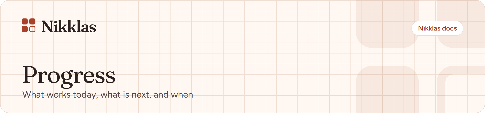
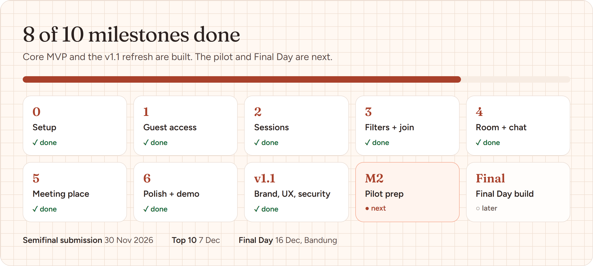
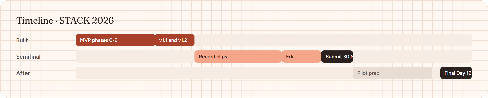
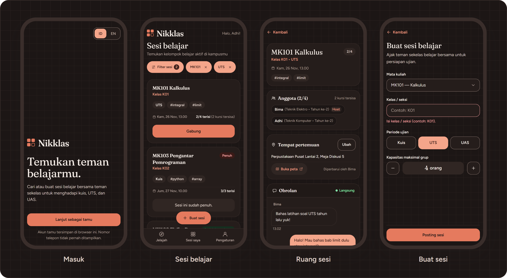
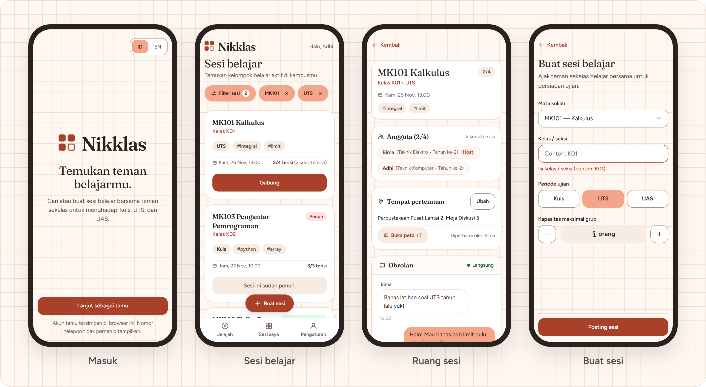

## Works today

| Area | What works | Phase |
| --- | --- | --- |
| Access | Guest sign-in that survives a reload; profile with nickname, major, year, up to 5 topics | 1 |
| Sessions | Post a session; feed with seats left; host joins automatically | 2 |
| Find and join | Filters by course, section, exam period and topic, run in the database; one-tap join; "My sessions" | 3 |
| Room | Member list and live chat (Supabase Realtime) for members only | 4 |
| Meeting place | Description and an `https://` map link that every member sees update | 5 |
| Languages | Every screen in Bahasa Indonesia and English | 0 to 6 |
| v1.1 | Brand, UX and security pass (below) | v1.1 |

## v1.2 (25 Nov 2026, evening)

- **Dark mode** in the Nikklas style: warm ink ground `#1C1615`, lifted clay `#E57A5E` with dark labels, peach for selection. Every text pair passes WCAG AA (body 15.6:1, muted 7.4:1, buttons 6.2:1). It follows the device by default; Settings has **System / Light / Dark**, saved in this browser and applied before the first paint, so there is no flash.
- **Landing version 3**, chosen by Adhi from three options: left-aligned, a small logo, the slogan large near the button where the thumb is.

## v1.1 changelog (25 Nov 2026)

**Brand**
- New logo (three seats taken, one open) as an SVG component and favicon; the name is spelled **Nikklas** everywhere, including the entry screen.
- Brand v1.1 tokens: clay `#A8402A` as the one accent with white labels, peach only for selected chips and your own chat bubbles, sand instead of lavender, Figtree instead of Inter, Fraunces at 400 to 600.
- Line icons replace all 14 emoji and the text arrows.

**UX**
- Inputs at 16 px, so iOS no longer zooms in on focus.
- Every tap target is at least 44 px, including filter chip remove buttons, sheet close buttons and the language switch.
- Create session: the exam period is a three-option segmented control and capacity is a − / + stepper (was two dropdowns).
- Bottom sheets close with Escape or a tap outside, move focus in and back, and stop the page behind from scrolling.
- Errors appear under their field, are linked with `aria-describedby`, and the first invalid field gets focus. No more `alert()` pop-ups.
- A full session shows "This session is full." instead of a dead button; join buttons name the session for screen readers.
- Bottom nav with icons and `aria-current`; a skip link; one `<main>` per page; a headings order that steps down.
- Copy: "kamu" instead of "Anda", sentence case labels, hardcoded Indonesian strings ("Kelas", "Kuis", "Mahasiswa") moved into the translation files.
- Buttons step up 1 px on hover and press down on tap (taste-skill motion rules); nothing moves under reduced motion.

**Security**
- [Hardening migration](docs/security.md#november-2026-hardening) for `session_members` and `sessions_feed`. **Needs to be run once in the Supabase SQL Editor.**

**Code health**
- `npm run lint` and `tsc --noEmit` pass with 0 errors (were 10 `any` errors and an impure render).

## Not done yet

| Item | Owner | When |
| --- | --- | --- |
| Run the hardening migration on the live Supabase project | Adhi | Before the video shoot |
| Scripted last-seat concurrency test | Rofi | Milestone 2 |
| Pilot: 7 students, 2 weeks, 3 measures ([plan](docs/pilot-plan.md)) | Fathir, Rofi | 1 to 15 Dec |
| Verified `.ac.id` sign-in | Adhi | Final Day |
| Report user or session, moderation table | Adhi, Haidar | Final Day |
| `.ics` calendar export and reminders | Haidar | Final Day |

## Known limitations

- Guest accounts live in one browser; clearing browser data loses them (stated on the entry and settings screens).
- Guests are not verified students; the pilot is invite-only until `.ac.id` sign-in ships.
- One campus and four seeded courses (`MK101` to `MK104`).
