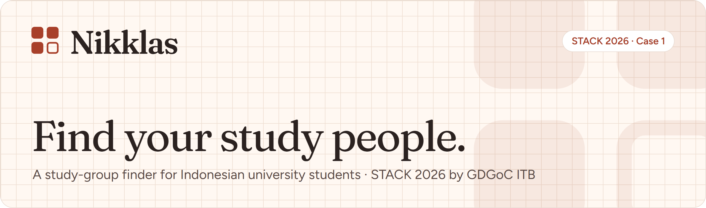
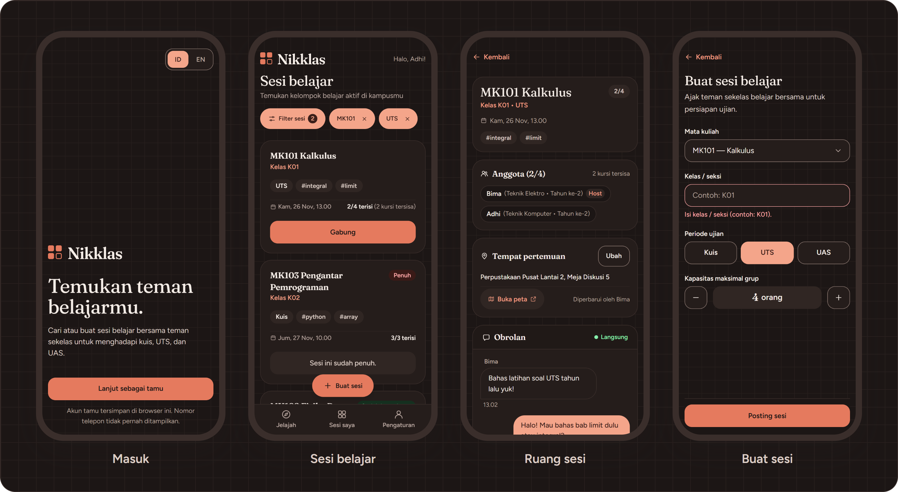
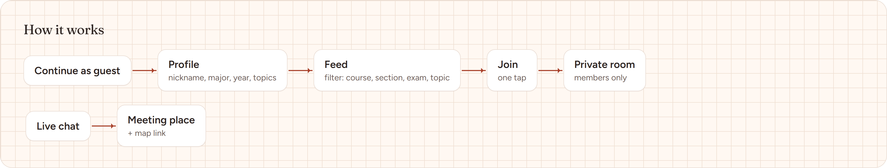
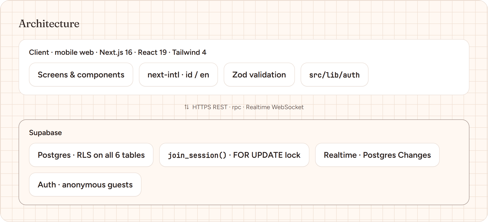

<p align="center"></p>

<p align="center">
  <a href="https://nikklas.vercel.app"><b>Open the app</b></a> ·
  <a href="PROGRESS.md">Progress</a> ·
  <a href="docs/proposal/Nikklas_Proposal_v2.pdf">Proposal</a> ·
  <a href="docs/brand/README.md">Brand</a> ·
  <a href="docs/video/README.md">Video</a>
</p>

<p align="center">
  
  
  
  
  
</p>

Nikklas is a mobile web app where Indonesian university students find or post a study session for their **course, class section and exam**, join in one tap, chat in a private room and agree on where to meet. Groups hold **2 to 8 seats**, and other members only see your nickname, major and year. **No phone number, ever.**

Built by team **Satu Orang Satu Ubin** for STACK 2026 by GDGoC ITB, Case 1: Smarter Campus and Learning.

<p align="center"></p>

<p align="center"></p>

<p align="center"><sub>Light and dark, both WCAG 2.2 AA. Dark follows the device, or pick it in Settings.</sub></p>

## How it works

<p align="center"></p>

## Architecture

<p align="center"></p>

Details: [security and data model](docs/security.md) · [blueprint](docs/blueprint.md) · [UI spec](docs/ui.md).

## Status

<p align="center"></p>

Done: guest access and profiles, sessions and feed, database filters and one-tap join, live room chat, meeting places, both languages, brand v1.1 and the UX and security pass. Next: the pilot (1 to 15 Dec) and, on Final Day, verified `.ac.id` sign-in, reporting and moderation, and calendar export. Full list in [PROGRESS.md](PROGRESS.md).

## Run it locally

1. `npm install`
2. Create a project on [supabase.com](https://supabase.com) and turn on **Authentication → Sign In / Providers → Allow anonymous sign-ins**.
3. `cp .env.example .env.local` and fill in `NEXT_PUBLIC_SUPABASE_URL` and `NEXT_PUBLIC_SUPABASE_ANON_KEY` (Project Settings → API).
4. In the Supabase SQL Editor, run the files in `supabase/migrations/` in name order, then enable Realtime:
   ```sql
   alter publication supabase_realtime add table public.messages;
   alter publication supabase_realtime add table public.meeting_places;
   ```
5. Run `supabase/seed.sql` for the four courses and labelled sample sessions (the cleanup line at its top removes them before a pilot).
6. `npm run dev` and open [localhost:3000](http://localhost:3000).

Checks: `npm run lint` and `npx tsc --noEmit` (both 0 errors), `npm run build`.

## Repository

```
docs/
  blueprint.md   ui.md   agent.md   security.md   pilot-plan.md   demo-script.md
  brand/         logo, palette, voice, brand book PDF
  phases/        build logs for phases 0 to 6
  proposal/      semifinal proposal v2 (current) and v1
  video/         semifinal video scripts and teleprompters
messages/        id.json, en.json
src/             app routes, components, lib (auth, sessions, chat, meeting-place, validation)
supabase/        migrations and seed
PROGRESS.md      what is done and what is next
```

## Team

| Member | Role |
| --- | --- |
| Muhammad Adhi Nawf Adrian | Founder and team lead · system architecture and backend |
| Muhammad Haidar Abiyyah Yahya | Frontend and UI/UX |
| Fathir Rachman Wicaksono | Product research, UX and copy |
| Muhammad Rofi Darmawan | QA and systems integration |

## Third-party resources and AI assistance

Next.js and React (MIT), Supabase (Apache 2.0), Tailwind CSS (MIT), next-intl (MIT), Zod (MIT), Fraunces and Figtree (SIL Open Font License 1.1).

Material AI assistance, as the STACK 2026 rules require:

- **Google Antigravity with Gemini** helped scaffold TypeScript and React code, draft the message files and write the phase logs in `docs/phases/`.
- **Kiro** helped with the v1.1 brand guidelines and logo, the UI, UX and accessibility pass, the security migration, these docs and the semifinal video script.

The team directed, reviewed and tested all of it and is responsible for the result.
