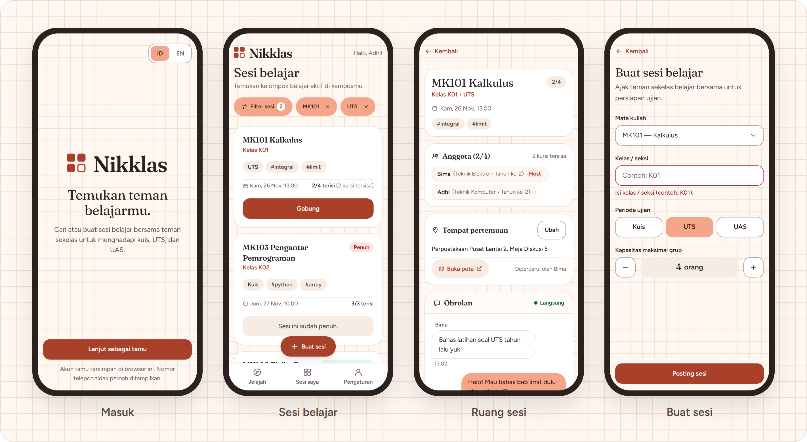
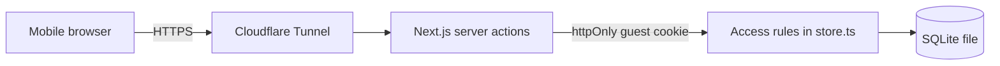
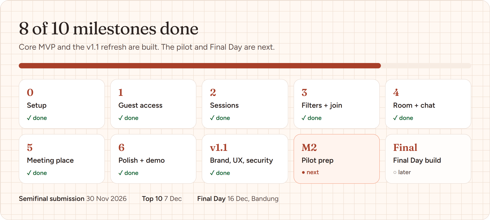

<p align="center"></p>

<p align="center">
  <a href="https://nikklas.web.id"><b>Open the app</b></a> ·
  <a href="PROGRESS.md">Progress</a> ·
  <a href="docs/proposal/Nikklas_Proposal_v2.pdf">Proposal</a> ·
  <a href="docs/brand/README.md">Brand</a> ·
  <a href="docs/video/README.md">Video</a>
</p>

<p align="center">
  
  
  
  
  
</p>

Nikklas is a mobile web app where Indonesian university students find or post a study session for their **course, class section and exam**, join in one tap, chat in a private room and agree on where to meet. Groups hold **2 to 8 seats**, and other members only see your nickname, major and year. **No phone number, ever.**

Built by team **Satu Orang Satu Ubin** for STACK 2026 by GDGoC ITB, Case 1: Smarter Campus and Learning.

<p align="center"></p>

<p align="center"></p>

<p align="center"><sub>Light and dark, both WCAG 2.2 AA. Dark follows the device, or pick it in Settings.</sub></p>

## How it works

<p align="center"></p>

## Architecture

One Next.js process on a self-hosted server. Data lives in one SQLite file through `node:sqlite`.



The open session room asks for new messages every 3 seconds, and for members and the meeting place every 5 seconds.

Details: [security and data model](docs/security.md) · [blueprint](docs/blueprint.md) · [UI spec](docs/ui.md). The blueprint and phase logs describe the first Supabase build.

## Status

<p align="center"></p>

Done: guest access and profiles, sessions and feed, database filters and one-tap join, live room chat, meeting places, both languages, brand v1.1 and the UX and security pass. Next: the pilot (1 to 15 Dec) and, on Final Day, verified `.ac.id` sign-in, reporting and moderation, and calendar export. Full list in [PROGRESS.md](PROGRESS.md).

## Run it locally

Needs Node 22.14 or newer (`npm test` needs 22.18 or newer). No account and no environment file.

1. `npm install`
2. `npm run seed` for labelled sample sessions (optional; remove them with `delete from users where id like 'demo-%';`).
3. `npm run dev` and open [localhost:3000](http://localhost:3000).

The database is created at `data/nikklas.db`. Set `NIKKLAS_DB` to store it elsewhere. The guest cookie is `Secure` in production, so serve a production build over HTTPS.

Checks: `npm test` (access rules and the last-seat race), `npm run lint`, `npx tsc --noEmit`, `npm run build`.

## Repository

```
docs/
  blueprint.md   ui.md   agent.md   security.md   pilot-plan.md   demo-script.md
  brand/         logo, palette, voice, brand book PDF
  phases/        build logs for phases 0 to 6
  proposal/      semifinal proposal v2 (current) and v1
  video/         semifinal video scripts and teleprompters
messages/        id.json, en.json
src/             app routes, components, lib (auth, sessions, chat, meeting-place, validation, server)
db/              schema and sample data
test/            access rules and concurrency tests
PROGRESS.md      what is done and what is next
```

## Team

| Member | Role |
| --- | --- |
| Muhammad Adhi Nawf Adrian | Founder and team lead · system architecture and backend |
| Muhammad Haidar Abiyyah Yahya | Frontend and UI/UX |
| Fathir Rachman Wicaksono | Product research, UX and copy |
| Muhammad Rofi Darmawan | QA and systems integration |

## Third-party resources and AI assistance

Next.js and React (MIT), SQLite (public domain), Tailwind CSS (MIT), next-intl (MIT), Zod (MIT), Fraunces and Figtree (SIL Open Font License 1.1).

Material AI assistance, as the STACK 2026 rules require:

- **Google Antigravity with Gemini** helped scaffold TypeScript and React code, draft the message files and write the phase logs in `docs/phases/`.
- **Claude Code** helped with the move to the self-hosted backend, its tests and the related docs.
- **Kiro** helped with the v1.1 brand guidelines and logo, the UI, UX and accessibility pass, the security migration, these docs and the semifinal video script.

The team directed, reviewed and tested all of it and is responsible for the result.
