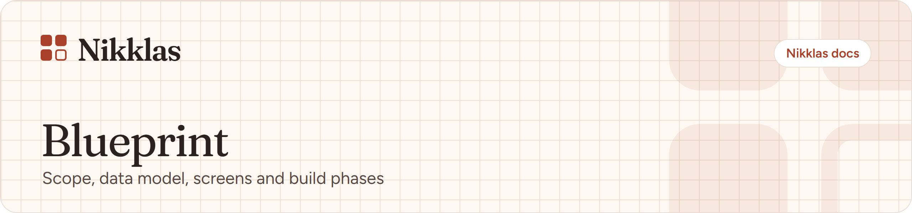

# Nikklas: Find your study people. Blueprint

> Team: Satu Orang Satu Ubin. Case 1: Smarter Campus and Learning (STACK GDGoC ITB).
> Build window: **9 days**. Audience for this file: the human team and any AI coding model.
> Companion file: `agent.md` (rules for AI models). Read both before writing code.

---

## 1. One-paragraph summary

Nikklas is a mobile-friendly web app, in Bahasa Indonesia and English, where Indonesian university students find or post study sessions for shared courses. Students without an established network (shy newcomers, transfer students, commuters) can filter sessions by course, section, exam period and topic tags, join with one tap, chat in a private session room, and agree on a meeting place. Phone numbers are never shown.

## 2. Problem and users

- **Problem:** Some students cannot find a study group at all, and even matched groups struggle to schedule meetings. Class group chats and social posts have no course, section or exam filters.
- **Users:** Indonesian university students in large shared courses, especially first- and second-year students, newcomers, transfer students and commuters, in the weeks before quizzes, UTS (midterms) and UAS (finals).
- **Evidence:** Published research only (not our own data). Most of it is non-Indonesian, so the pilot tests it locally.

## 3. MVP scope (9 days)

**In scope**
1. Guest sign-in (no Google, no password) plus a profile: nickname, major, year, up to 5 topic tags.
2. Post a study session: course, section, exam period, topic tags, date/time, max group size.
3. Browse a feed of sessions and filter by course, section, exam period and tags.
4. Join a session with one tap (with a group-full limit).
5. Session room: member list and live text chat.
6. Meeting place: a text description and a pasted map link, visible to all members.
7. Interface in Bahasa Indonesia and English through translation files.
8. One campus, four courses, entered manually as seed data.

**Out of scope (do not build unless the team asks)**
- Google login or any other sign-in provider; real university-email verification.
- Notifications (push or email), ratings, reviews, admin panel, moderation tools.
- Images, files, voice or video in chat; typing indicators; read receipts.
- Automatic matching algorithms or recommendations.
- Native mobile apps.

## 4. How guest sign-in works (and the honest gap)

- Use **Supabase anonymous sign-in**. A student taps "Continue as guest", fills in the profile, and gets a real private user ID behind the scenes. All database privacy rules work the same as with real accounts.
- **Limitation:** A guest account lives in one browser. Clearing browser data or switching phones loses it. This is acceptable for the demo and pilot.
- **Gap versus the abstract:** The abstract promises verified `.ac.id` email. Guest mode is the **prototype stage**; verification is the **next step**. Be ready to say this to judges.
- **Risk:** Guests are not verified as real students, so fake accounts and spam are possible. Mitigation: the pilot is small and invite-only.
- Real login is a **stretch goal** (section 10). Keep sign-in code isolated (one auth module) so it can be swapped later without rebuilding the app.

## 5. Data model (plain terms)

| Table | Purpose | Key fields |
|---|---|---|
| `profiles` | One row per user | `id` (same as auth user ID), `nickname`, `major`, `year` (1-6), `topic_tags` (max 5), `locale` (`id` or `en`) |
| `courses` | Course list (seeded) | `id`, `code`, `name`, `campus` |
| `sessions` | A posted study session | `id`, `host_id`, `course_id`, `section`, `exam_period` (`quiz`, `uts`, `uas`), `topic_tags` (max 5), `starts_at`, `max_size` (2-8), `status` (`open`, `full`, `closed`), `created_at`, `filled_at` |
| `session_members` | Who joined what | `session_id`, `user_id`, `joined_at`; unique per pair. The host is added automatically as a member. |
| `messages` | Chat messages | `id`, `session_id`, `user_id`, `body` (max 1000 chars), `created_at` |
| `meeting_places` | One place per session | `session_id`, `description`, `map_url`, `updated_by`, `updated_at` |

`filled_at` exists to measure "time from posting to a full group" in the pilot.

### Privacy and security rules (enforced in the database, not only in the UI)

- No phone numbers or real email addresses are stored or shown. Members see nicknames only.
- Anyone signed in (including guests) can read `courses`, and can read `sessions` that are `open` or `full` (feed), plus the member count.
- Only members of a session can read its `messages`, its member list and its `meeting_places` row.
- Only the author can insert a message as themselves, and only if they are a member.
- Joining goes through one database function that checks, in a single step, that the session is open, the user is not already in it, and there is room. It sets status to `full` and records `filled_at` when the last seat is taken.
- Only the host can close a session. Any member can set or update the meeting place.
- Users can read and edit only their own profile (other members' nickname, major and year are visible inside shared rooms).
- Row Level Security (RLS) is enabled on every table.

## 6. Screens

1. **Landing / guest entry:** app name, tagline, language switch, "Continue as guest".
2. **Profile setup:** nickname, major, year, up to 5 tag chips.
3. **Feed:** list of session cards (course, section, exam period, tags, time, seats left) with a filter bar.
4. **Create session:** form with the fields in section 3.
5. **Session room:** header (course, time), member list, chat, meeting place card.
6. **My sessions:** sessions the user hosts or joined.
7. **Profile / settings:** edit profile, switch language.

Design: mobile-first (design at 360 px wide first), large tap targets, clear empty states ("No sessions yet. Create the first one"), friendly and low-pressure wording for shy users.

## 7. Seed data (placeholder, rename later)

- Campus: `Kampus Contoh`
- Courses: `MK101 Kalkulus`, `MK102 Fisika Dasar`, `MK103 Pengantar Pemrograman`, `MK104 Kimia Dasar`
- Sections: `K01`, `K02`, `K03`
- Exam periods: `quiz`, `uts`, `uas`
- Sample tags: `integral`, `limit`, `mekanika`, `python`, `array`, `stoikiometri`
- Add 8-10 sample sessions from fake guest profiles so the feed is never empty at demo time. Mark them clearly as sample in the seed script, so they can be deleted before the real pilot.

---

## 8. Build phases

Work **one phase at a time**. Finish the "Done when" checklist and the demo check before starting the next phase. Each phase should leave the app in a working, deployable state.

### Phase 0: Setup (Day 1)

**Goal:** An empty but deployed app with the backend connected.

Tasks
- Create the Next.js project (TypeScript, Tailwind CSS, App Router).
- Create a Supabase project; enable anonymous sign-ins in the dashboard.
- Add environment variables locally and on Vercel (see `agent.md`).
- Add `next-intl` with `id` and `en` message files and a language switch stub.
- Create the database tables, RLS rules and the join function from section 5 in a single migration file.
- Add the seed script for courses (sessions come in Phase 6).
- Deploy to Vercel.

Done when
- [ ] App runs locally and on a public Vercel URL.
- [ ] Tables exist with RLS enabled; courses are seeded.
- [ ] Switching language changes a visible heading.

Demo check: open the public URL on a phone and see the landing page in both languages.

### Phase 1: Guest access and profile (Days 1-2)

**Goal:** A student can enter as a guest and set up a profile.

Tasks
- "Continue as guest" triggers Supabase anonymous sign-in; session persists on reload.
- Profile form: nickname, major, year, up to 5 tags (validate the limit).
- Redirect rules: not signed in goes to landing; signed in without a profile goes to setup; otherwise goes to feed.
- Isolate all auth code in one module (for a future real-login swap).

Done when
- [ ] Guest entry works on mobile and survives a page refresh.
- [ ] Profile saves and can be edited; the 6th tag is blocked.
- [ ] A user cannot read or edit another user's profile row (verify with two browsers).

Demo check: two different phones enter as guests with different profiles.

### Phase 2: Sessions (Days 3-4)

**Goal:** Students can post sessions and see them in a feed.

Tasks
- Create-session form with validation (future start time, group size 2-8, up to 5 tags).
- Feed page listing open sessions, newest or soonest first, with seats left.
- Session card component (reused later).
- Empty state and loading state.

Done when
- [ ] A posted session appears in the feed on another device.
- [ ] Invalid forms show clear, translated error messages.
- [ ] The host is automatically a member and counts toward group size.

Demo check: create a session on phone A, see it on phone B.

### Phase 3: Filters and join (Day 5)

**Goal:** Students can narrow the feed and join in one tap.

Tasks
- Filter bar: course, section, exam period, tags (any combination). Filter in the database query, not in the browser after loading everything.
- Join button calling the join function; show clear results for "joined", "already joined", "group full".
- When the last seat is taken, status becomes `full` and the card shows "Full".
- "My sessions" screen.

Done when
- [ ] Each filter works alone and in combination; clearing filters restores the list.
- [ ] Two users joining the last seat at the same time: exactly one succeeds.
- [ ] Joined sessions appear in "My sessions".

Demo check: filter to one course and exam period, join, and watch seats left drop.

### Phase 4: Session room (Day 6)

**Goal:** Members chat in a private room.

Tasks
- Room page with member list (nicknames, major, year) and text chat.
- Live updates using Supabase Realtime; new messages appear without refresh.
- Message validation (not empty, max 1000 characters); auto-scroll to the newest message.
- Non-members cannot open a room or read its messages (enforced by RLS, plus a friendly redirect in the UI).

Done when
- [ ] Two members see each other's messages within about 2 seconds.
- [ ] A non-member cannot read messages even by guessing the URL.
- [ ] No phone numbers or email addresses appear anywhere.

Demo check: two phones chat in the same room live.

### Phase 5: Meeting place (Day 7)

**Goal:** The group agrees on where to meet.

Tasks
- Meeting place card in the room: description plus map link, editable by any member.
- Validate the map link (must be `https://`); open it in a new tab with safe link attributes.
- Show "No place chosen yet" until set; show who last updated it.

Done when
- [ ] A member sets a place and all members see it update.
- [ ] A non-`https` link is rejected.
- [ ] Full flow works: sign in, post, join, chat, pick place.

Demo check: run the complete six-step flow start to finish in under two minutes.

### Phase 6: Polish and demo (Days 8-9)

**Goal:** A stable, good-looking demo and a ready pilot.

Tasks
- Seed the 8-10 sample sessions; test every screen at 360 px and 768 px wide.
- Review all text in Bahasa Indonesia and English; fix missing translations.
- Fix the top bugs from a full manual test; add error and empty states everywhere.
- Write the demo script (section 11) and rehearse it twice.
- Prepare the pilot sheet (section 9).
- Remove console logs and test data; confirm no secret keys are in the repo.

Done when
- [ ] Acceptance checklist (section 12) is fully ticked.
- [ ] Demo runs twice in a row without problems on the public URL.
- [ ] README explains setup in under 10 steps.

---

## 9. Pilot plan (after the build)

- Two weeks, 7 students, one faculty, invite-only.
- Measure: (1) time from posting to a full group (`filled_at - created_at`), (2) share of posted sessions that fill, (3) a 1-5 comfort rating collected through a short external form.
- Main risk: too few active users. Mitigation: one faculty only, and seed the first sessions together with the pilot students.

## 10. Stretch goals (only after Phase 6 is done)

1. Real sign-in with verified `.ac.id` email, then Google, using the isolated auth module.
2. Report-a-user button and simple moderation.
3. Reminders before a session starts.
4. Seed more courses and a second campus.

## 11. Demo script (about 2 minutes)

1. Show the problem in one sentence: "Newcomers and commuters often study alone."
2. Phone A: Continue as guest, set profile.
3. Filter the feed by course and exam period.
4. Phone B: post a session; show it appearing on Phone A.
5. Phone A: join in one tap; open the room.
6. Chat live between the two phones.
7. Set the meeting place with a map link.
8. Switch the language to English.
9. Close: guest mode is the prototype; verified `.ac.id` sign-in is the next step.

## 12. Final acceptance checklist

- [ ] All six core steps work on a real phone using the public URL.
- [ ] Both languages are complete on every screen.
- [ ] RLS is on for every table; a non-member cannot read a room's messages.
- [ ] No phone numbers, emails or secret keys are exposed anywhere.
- [ ] Group-full limit cannot be exceeded.
- [ ] Empty, loading and error states exist on every list and form.
- [ ] Seed data is present and labelled as sample.
- [ ] Every item in section 3 "Out of scope" is still not built.

## 13. Risks

| Risk | Impact | Mitigation |
|---|---|---|
| Too few active users | Pilot shows nothing | One faculty, invite-only, seed sessions together |
| Guests are unverified | Fake accounts or spam | Small invite-only pilot; verified login as the next step |
| Guest account lost when browser data is cleared | User loses sessions | Tell users on the landing screen; fix with real login later |
| Time overrun | Missing core flow | Work strictly in phase order; cut stretch goals first |
| Evidence is non-Indonesian | Claims may not transfer | State this openly; the pilot tests it locally |
