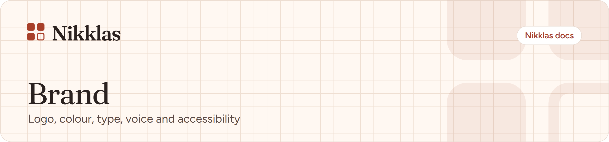
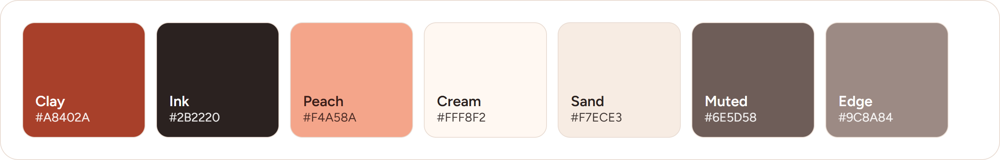

The mark is a study session seen from above: four seats, three taken, one open. It is the moment the app exists for: there is a seat left, so join.

| File | What it covers |
| --- | --- |
| [Nikklas_Brand_Guidelines_v1.1.pdf](Nikklas_Brand_Guidelines_v1.1.pdf) | The designed brand book |
| [guidelines.md](guidelines.md) | Brand book in text |
| [identity.md](identity.md) | Logo, colour, type, icons, accessibility |
| [voice.md](voice.md) | How Nikklas writes, in Indonesian and English |
| [messaging.md](messaging.md) | Tagline, core message, proof points |
| [positioning.md](positioning.md) | Where Nikklas sits against class chats and LMS forums |
| [naming.md](naming.md) | Name check and spelling (Nikklas: two k, one l) |
| [tokens.css](tokens.css) | The same tokens as `src/app/globals.css` |
| [assets/](assets) | SVG logos and marks |

Built with [cofoundy/brand-skills](https://github.com/cofoundy/brand-skills) and the UI rules of [leonxlnx/taste-skill](https://github.com/leonxlnx/taste-skill).
