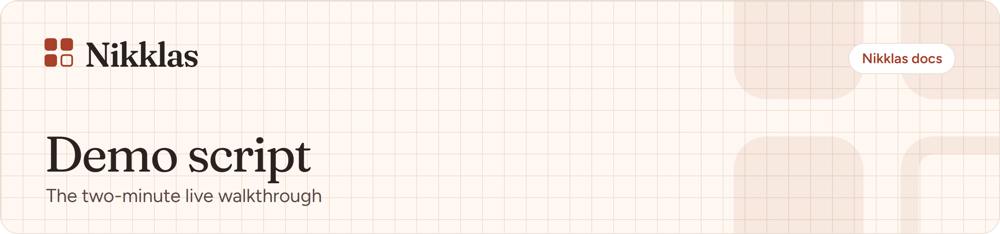

# Nikklas Demo Script (2-Minute Walkthrough)

This script follows **blueprint.md Section 11**. It is designed for hackathon judges, peer evaluations, or faculty demos using two devices (or two browser windows / incognito sessions side-by-side).

---

## Preparation Before Demo

- **Device A (Phone A):** Opened to `https://<your-deployed-url>` or `http://localhost:3000` (e.g. Regular browser window).
- **Device B (Phone B):** Opened to the same URL in an Incognito / Private window or second mobile phone.
- **Pre-seeded data:** Ensure `supabase/seed.sql` has been executed so the feed has realistic courses and sample sessions.

---

## 2-Minute Script Timeline

| Time | Device / Role | Action & Talking Points |
|---|---|---|
| **0:00 - 0:15** | Presenter | **Problem Statement (1 Sentence):** *"Mahasiswa baru dan mahasiswa perantau atau komuter sering kali terpaksa belajar sendiri karena belum punya jejaring pertemanan di kelas mereka. Nikklas mempermudah mahasiswa menemukan rekan belajar untuk kuis, UTS, dan UAS hanya dalam hitungan detik."* |
| **0:15 - 0:30** | Phone A | **Guest Entry & Profile:** 1. Tap **"Lanjut sebagai tamu"** (no phone number or passwords required). 2. Set nickname (e.g. `Adhi`), Major (`Teknik Informatika`), Year (`2`), and select tags (`#kalkulus`, `#integral`). 3. Tap **"Simpan dan lanjut"** &rarr; arrives on the Feed. |
| **0:30 - 0:45** | Phone A | **Feed & Filtering:** 1. Show feed of course sessions. 2. Tap **Filter** &rarr; select Course `MK101 Kalkulus` and Exam Period `UTS`. 3. Tap **Terapkan Filter** &rarr; feed updates instantly, demonstrating database-level query filtering. |
| **0:45 - 1:05** | Phone B | **Post a Session:** 1. Enter as guest on Phone B (e.g. `Bima`, `Teknik Elektro`). 2. Tap floating **"+" (Buat sesi)** button. 3. Select Course `MK101 Kalkulus`, Section `K01`, Exam Period `UTS`, set Capacity `3`, and tap **"Posting Sesi"**. 4. Switch to Phone A &rarr; the new study session appears in the feed! |
| **1:05 - 1:20** | Phone A | **One-Tap Join Flow:** 1. Phone A taps **"Gabung"** on Phone B's session. 2. Notice seat count instantly increases, success toast appears. 3. Tap **"Buka Ruang"** to enter the private session room. |
| **1:20 - 1:35** | Phone A & Phone B | **Live Chat Room:** 1. Phone B opens the room. 2. Phone A types: *"Halo! Mau bahas bab limit dulu atau integral?"* and taps **Kirim**. 3. Phone B receives the message live (via Supabase Realtime) in under 2 seconds without refreshing. 4. Phone B replies: *"Bahas latihan soal UTS tahun lalu yuk!"* |
| **1:35 - 1:50** | Phone B & Phone A | **Agreed Meeting Place:** 1. Phone B taps **"Usulkan Tempat"**. 2. Inputs: `Perpustakaan Pusat Lantai 2, Meja Diskusi 5` and Google Maps URL `https://maps.google.com/?q=Perpustakaan+Pusat`. 3. Tap **"Simpan Tempat"**. 4. Meeting place card instantly updates on Phone A, with safe `target="_blank"` link to Google Maps. |
| **1:50 - 2:00** | Phone A | **Language Switch & Pitch Close:** 1. Tap **Pengaturan** in bottom navigation. 2. Switch language to **English** &rarr; interface immediately reflects English translations. 3. **Closing Remark:** *"Mode tamu ini adalah prototipe untuk memverifikasi kenyamanan interaksi antar mahasiswa tanpa hambatan registrasi. Tahap berikutnya adalah integrasi email kampus resmi (.ac.id) untuk verifikasi identitas mahasiswa."* |

---

## Key Demo Talking Points

1. **Zero Barrier Entry:** Students join in under 30 seconds as anonymous guests; no phone numbers or personal emails are exposed.
2. **Race-Condition Safe:** Concurrency-tested atomic SQL locking prevents study groups from exceeding capacity.
3. **Privacy First:** Chat rooms and meeting places are locked by Postgres Row Level Security (RLS) to enrolled session members only.
