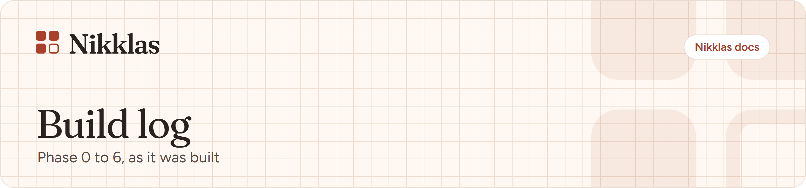
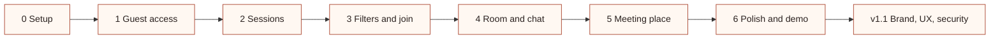

Adhi built the MVP in seven phases on 21 November 2026, one commit and one log per phase.

| Phase | Goal | Status |
| --- | --- | --- |
| [0](phase-0.md) | Setup | done |
| [1](phase-1.md) | Guest access and profile | done |
| [2](phase-2.md) | Sessions | done |
| [3](phase-3.md) | Filters and join | done |
| [4](phase-4.md) | Session room | done |
| [5](phase-5.md) | Meeting place | done |
| [6](phase-6.md) | Polish and demo | done |
| [v1.1](../../PROGRESS.md) | Brand, UX and security pass | done |
