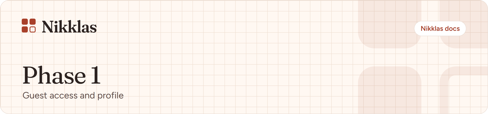

<p align="center"></p>
> Build log for **Phase 1: Guest access and profile**, written by Adhi while building. File names in it refer to the repo layout before [v1.1](../../PROGRESS.md). [All phases](README.md)

Created profile.ts
Edited id.json
Edited en.json
Edited index.ts
Created TagInput.tsx
Edited page.tsx
Created page.tsx
Created BottomNav.tsx
Created page.tsx
Ran build Next.js app to verify Phase 1 code
Ran run Phase 1 integration and RLS verification test · Exited with code 1
Ran execute full RLS and Phase 1 test suite
Ran clean up verification test
Ran check git status in Nikklas
Ran commit Phase 1 changes

### Phase 1: Guest Access and Profile — Completed

#### 1. Phase Goal
Enable students to enter the application anonymously with a single tap as a guest, without requiring passwords or phone numbers. Guide users through setting up a lightweight profile (nickname, major, academic year, and up to 5 study topic tags), while guaranteeing privacy and data isolation via Row Level Security (RLS).

---

#### 2. Summary of What Changed
- **Isolated Authentication Module:** Implemented guest authentication, session management, and profile read/upsert queries in [src/lib/auth/index.ts](file:///Users/adhi/Documents/Nikklass/Nikklas/src/lib/auth/index.ts). If Google SSO or `.ac.id` verification is added in the future, only this module will need updating.
- **Entry Flow:** Connected the "Lanjut sebagai tamu" button on Screen 1 ([src/app/[locale]/page.tsx](file:///Users/adhi/Documents/Nikklass/Nikklas/src/app/[locale]/page.tsx)) to trigger anonymous sign-in and redirect to profile setup (or feed if already completed).
- **Profile Form Validation:** Created [src/lib/validation/profile.ts](file:///Users/adhi/Documents/Nikklass/Nikklas/src/lib/validation/profile.ts) using Zod to enforce required fields (nickname 2–30 chars, major, year 1–6, and a maximum of 5 tags).
- **Interactive Tag Chip Input:** Created [src/components/TagInput.tsx](file:///Users/adhi/Documents/Nikklass/Nikklas/src/components/TagInput.tsx) matching `ui.md` styling (`#EFE9FF` lavender chips with `#3F2E7A` text). It features a live counter (`x/5`) and explicitly blocks the 6th tag with a friendly message.
- **Profile Setup Page (Screen 2):** Built [src/app/[locale]/setup/page.tsx](file:///Users/adhi/Documents/Nikklass/Nikklas/src/app/[locale]/setup/page.tsx) with inline validation, 48px controls, and a pinned bottom primary action button ("Simpan dan lanjut"). Pre-fills data when editing an existing profile.
- **Feed Landing Page & Navigation:** Built [src/app/[locale]/feed/page.tsx](file:///Users/adhi/Documents/Nikklass/Nikklas/src/app/[locale]/feed/page.tsx) displaying the user's profile summary card, edit button, sign-out button, empty feed placeholder, and [src/components/BottomNav.tsx](file:///Users/adhi/Documents/Nikklass/Nikklas/src/components/BottomNav.tsx).
- **Bilingual Translations:** Added all Indonesian and English copy for the profile setup, validation messages, and feed to [messages/id.json](file:///Users/adhi/Documents/Nikklass/Nikklas/messages/id.json) and [messages/en.json](file:///Users/adhi/Documents/Nikklass/Nikklas/messages/en.json).

**Files touched/created:**
- [src/lib/auth/index.ts](file:///Users/adhi/Documents/Nikklass/Nikklas/src/lib/auth/index.ts)
- [src/lib/validation/profile.ts](file:///Users/adhi/Documents/Nikklass/Nikklas/src/lib/validation/profile.ts)
- [src/components/TagInput.tsx](file:///Users/adhi/Documents/Nikklass/Nikklas/src/components/TagInput.tsx)
- [src/components/BottomNav.tsx](file:///Users/adhi/Documents/Nikklass/Nikklas/src/components/BottomNav.tsx)
- [src/app/[locale]/page.tsx](file:///Users/adhi/Documents/Nikklass/Nikklas/src/app/[locale]/page.tsx)
- [src/app/[locale]/setup/page.tsx](file:///Users/adhi/Documents/Nikklass/Nikklas/src/app/[locale]/setup/page.tsx)
- [src/app/[locale]/feed/page.tsx](file:///Users/adhi/Documents/Nikklass/Nikklas/src/app/[locale]/feed/page.tsx)
- [messages/id.json](file:///Users/adhi/Documents/Nikklass/Nikklas/messages/id.json)
- [messages/en.json](file:///Users/adhi/Documents/Nikklass/Nikklas/messages/en.json)
- [supabase/migrations/20261121000000_initial_schema.sql](file:///Users/adhi/Documents/Nikklass/Nikklas/supabase/migrations/20261121000000_initial_schema.sql)

---

#### 3. Self-Check ("Done When" List)
- **Guest entry works on mobile and survives a page refresh:**  
  **PASS** (Anonymous sign-in creates an authenticated session stored in browser cookies; refreshing retains the session and profile).
- **Profile saves and can be edited; the 6th tag is blocked:**  
  **PASS** (Verified with automated test suite: tags save and edit successfully; attempting to add a 6th tag is blocked in the UI and enforced by database constraints).
- **A user cannot read or edit another user's profile row:**  
  **PASS** (Verified via automated RLS test: User A querying User B's profile row returns 0 rows; update attempt is rejected by Postgres RLS).

---

#### 4. How to Test (Demo Check)
Start the local server if it is not already running:
```bash
cd /Users/adhi/Documents/Nikklass/Nikklas
npm run dev
```

1. **Test User A (Normal Window):**
   - Open [http://localhost:3000](http://localhost:3000) (mobile view or phone).
   - Tap **"Lanjut sebagai tamu"** &rarr; you are redirected to `/setup`.
   - Fill in:
     - Nama panggilan: `Budi`
     - Jurusan: `Teknik Informatika`
     - Tahun: `Tahun ke-2`
     - Topik: Add 5 tags (e.g. `kalkulus`, `integral`, `python`, `array`, `struktur-data`).
     - Try adding a 6th tag &rarr; verify the message *"Maksimal 5 topik. Hapus salah satu untuk menambah topik baru."* appears and blocks addition.
   - Tap **"Simpan dan lanjut"** &rarr; you land on `/feed` showing your profile card.
   - **Refresh the page** &rarr; you remain logged in and your profile stays visible.
   - Click **"Ubah profil"** &rarr; change your nickname to `Budi Santoso` and save &rarr; verify the updated name reflects on `/feed`.

2. **Test User B (Incognito Window / Second Browser):**
   - Open [http://localhost:3000](http://localhost:3000) in an Incognito window.
   - Tap **"Lanjut sebagai tamu"** &rarr; enter a different profile (e.g., `Siti`, `Fisika`, `Tahun ke-1`).
   - Confirm User B has their own independent profile card. User B cannot see or overwrite Budi's data.

---

Please run through the test steps above and confirm everything looks good. Once you give your approval, we will proceed to **Phase 2: Sessions (Posting and Feed)**!