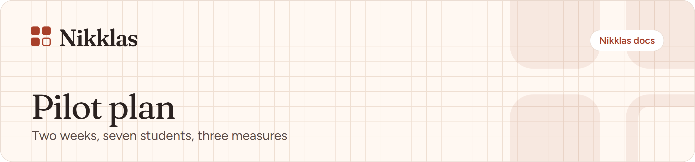

# Nikklas Pilot Plan

This document defines the post-build evaluation plan for **Nikklas**, following **blueprint.md Section 9**.

---

## 1. Pilot Scope & Parameters

- **Duration:** 2 Weeks (14 calendar days).
- **Cohort Size:** 7 Students (Targeting 1st & 2nd year students).
- **Scope Restriction:** 1 Faculty (e.g. STEI / FMIPA), invite-only via a private pilot group link.
- **Initial Setup:** The pilot coordinator seeds the first 3-4 study sessions alongside pilot participants during an onboarding session.

---

## 2. Quantitative & Qualitative Metrics

To determine whether Nikklas solves the core pain point ("commuter and newcomer students studying alone"), the pilot measures three core key performance indicators (KPIs):

### Metric 1: Time to Fill (Velocity)
- **Definition:** The duration from session creation until the group reaches maximum capacity.
- **Formula:** `filled_at - created_at` (recorded in Postgres `public.sessions`).
- **Success Target:** Median fill time under 4 hours during exam preparation weeks (Kuis/UTS).

### Metric 2: Completion Rate (Fill Rate)
- **Definition:** The proportion of posted study sessions that reach full capacity (`status = 'full'`).
- **Formula:** `(Total Full Sessions / Total Created Sessions) * 100%`.
- **Success Target:** &ge; 60% of posted study sessions reach capacity.

### Metric 3: Student Comfort Rating (Psychological Safety)
- **Definition:** Student comfort and perceived low-pressure atmosphere during group discovery and initial interaction.
- **Instrument:** Short 3-question Google Form distributed at the end of Day 7 and Day 14:
  1. *Seberapa nyaman Anda mencari dan bergabung ke kelompok belajar melalui Nikklas?* (Rating: 1 - 5).
  2. *Apakah ketiadaan nomor telepon/email membuat Anda merasa lebih aman berinteraksi?* (Ya / Ragu / Tidak).
  3. *Kendala apa yang paling terasa saat berkoordinasi menentukan waktu & tempat?* (Free text).
- **Success Target:** Average comfort rating &ge; 4.0 / 5.0.

---

## 3. Risk Matrix & Mitigations

| Risk | Impact | Likelihood | Mitigation Strategy |
|---|---|---|---|
| **Too few active users (Cold Start)** | Feed feels empty, sessions do not fill, discouraging participants. | High | Keep pilot strictly within **one faculty**; conduct a live onboarding session where participants and coordinator seed study sessions together. |
| **Unverified guest accounts / Trolling** | Inappropriate messages or fake accounts. | Medium | Invite-only cohort with a shared code of conduct; coordinator has database access to delete malicious sessions; verified `.ac.id` email login scheduled as next phase. |
| **Local storage loss / Cleared browser cache** | Student clears browser history and loses their anonymous session. | Low | Explicitly communicated in Landing screen and Settings page; keep sessions active within short timeframes (1-3 days). |
| **Cultural fit of study habits** | Indonesian students may prefer existing informal WhatsApp/LINE groups. | Medium | Emphasize low friction: no need to ask "siapa yang mau belajar bareng?" in a 300-person class group. Nikklas acts as a lightweight matchmaking bridge, not a permanent social network. |

---

## 4. Timeline & Milestones

- **Day 0 (Kickoff):** Distribute pilot link to 7 students; 15-minute walkthrough; seed 3 initial sessions together.
- **Day 1 - 6 (Week 1 Monitoring):** Track session creation rates and join velocities in Supabase dashboard.
- **Day 7 (Mid-Pilot Check):** Distribute 2-minute pulse survey (Comfort rating).
- **Day 8 - 13 (Week 2 Operation):** Monitor organic session creation before scheduled midterms/quizzes.
- **Day 14 (Debrief & Synthesis):** Final survey, calculate Metric 1, Metric 2, and Metric 3, and present findings for Phase 7 (`.ac.id` authentication integration).
