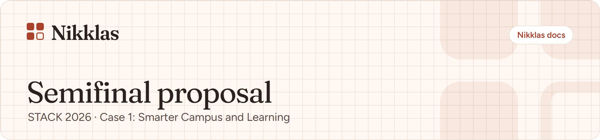

| File | Status |
| --- | --- |
| [Nikklas_Proposal_v2.pdf](Nikklas_Proposal_v2.pdf) | **Current.** Follows the STACK 2026 handbook: 11 pt, 2.5 cm margins, 9 content pages, official declaration text. Needs Adhi's signature on the last page before submission. |
| [Nikklas_Proposal_v1.pdf](Nikklas_Proposal_v1.pdf) · [proposal-v1.md](proposal-v1.md) | Archived first draft |

**What changed in v2**

- Name spelled Nikklas everywhere; "Realtime Postgres Changes" instead of "Broadcast"; Institut Teknologi Bandung.
- New sections: 3.4 Interface and accessibility (contrast table), 6.3 Privacy and data handling, data sources in 4.2.
- Mockups labelled as mockups; the last-seat concurrency test marked as not yet run; evidence written as hypotheses for the pilot.
- AI disclosure lists Google Antigravity with Gemini and Kiro.
- Official Declaration of Originality, signed by the team leader.

Semifinal submission: **30 November 2026, 23:59 WIB**. The PDF upload opens after the semifinal payment is verified, and the file cannot be replaced after submission.
