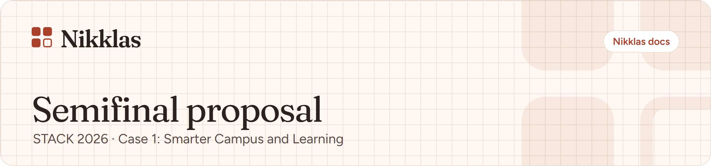

<p align="center"></p>
> **Archived.** First semifinal draft, kept for history. The current proposal is [`Nikklas_Proposal_v2.pdf`](Nikklas_Proposal_v2.pdf) ([what changed](README.md)).

# Nikklas: A Privacy-Conscious Peer Study-Group Finder for Indonesian University Students

**Competition:** STACK 2026 by GDGoC ITB  
**Track:** Case 1 — Smarter Campus and Learning  
**Team Name:** Satu Orang Satu Ubin  
**Members:**
- Muhammad Adhi Nawf Adrian (Team Leader)
- Muhammad Haidar Abiyyah Yahya
- Fathir Rachman Wicaksono
- Muhammad Rofi Darmawan

---

## 1. Project and Team Identity

| Field | Details |
|---|---|
| **Project Title** | **Nikklas** — Find Your Study People |
| **Team Name** | Satu Orang Satu Ubin |
| **Selected Case** | Case 1: Smarter Campus and Learning (*"Difficulty finding suitable study partners"*) |
| **Team Leader** | Muhammad Adhi Nawf Adrian — Team Coordination & System Architecture |
| **Team Members** | Muhammad Haidar Abiyyah Yahya — Frontend & User Interface Development |
| | Fathir Rachman Wicaksono — Product Research & User Experience |
| | Muhammad Rofi Darmawan — Quality Assurance & System Reliability |

---

## 2. Problem and User Analysis

### 2.1 Problem Context
Across Indonesian universities, first- and second-year undergraduate courses frequently enroll 100 to 300+ students per cohort. While collaborative peer learning is widely recognized as one of the most effective strategies for mastering challenging foundational subjects—such as Calculus, Basic Physics, Introductory Programming, and Basic Chemistry—students routinely end up preparing for quizzes (*Kuis*), midterms (*UTS*), and finals (*UAS*) alone.

This isolation is particularly acute for **commuter students**, **newcomers**, and **off-campus (*kosan*) residents** who lack pre-existing social circles on campus. Even when students are enrolled in the exact same course section, there is no lightweight, structured mechanism to discover who else wants to study the same topics at the same time.

### 2.2 Target Users
- **Primary Users:** First- and second-year Indonesian university students preparing for high-stakes exams (Kuis, UTS, UAS).
- **Underserved Segments:**
  1. **Commuter & *Kosan* Students:** Learners who leave campus immediately after lectures and miss informal hallway interactions.
  2. **Introverted or Shy Learners:** Students who want academic collaboration but feel intimidated by unstructured social outreach.
  3. **Transfer or Out-of-Cohort Students:** Students retaking a course or joining a section where they know no one.

### 2.3 Supporting Observations & Friction Points
In Indonesian campus culture, course communication typically defaults to massive, informal **WhatsApp** or **LINE** class groups. Through direct student observation and problem analysis, we identified four recurring barriers in these existing channels:
1. **High Social Risk ("Cold-Start" Anxiety):** Asking *"Ada yang mau belajar bareng?"* in a 300-person chat exposes the student publicly, creating fear of being ignored or appearing unprepared.
2. **Information Burial:** Useful messages are quickly buried under administrative announcements, memes, and unrelated chatter.
3. **Privacy Exposure:** Participating in WhatsApp/LINE groups forces students to expose their personal phone numbers or social media profiles to strangers.
4. **Uncoordinated Group Sizes:** Without capacity caps, impromptu meetups either fail to gain traction or become overcrowded and unproductive.

*(Note: In accordance with STACK 2026 reporting guidelines, quantitative pilot metrics will be collected during our scheduled two-week campus pilot rather than fabricating pre-pilot survey statistics.)*

### 2.4 Analysis of Existing Alternatives

| Criterion | Class WhatsApp / LINE Groups | Campus LMS Forums | General Social Media | **Nikklas (Proposed)** |
|---|---|---|---|---|
| **Course & Exam Filtering** | None (chronological chat) | Course-level only | None | **Course, section, exam period & topic tags** |
| **Social Pressure** | High (public broadcast) | Medium (formal/graded feel) | High | **Low (structured intent matching)** |
| **Personal Privacy** | Exposes phone number / ID | Exposes full student ID | Exposes personal profile | **Nicknames, major & year only** |
| **Capacity Control** | None | None | None | **Strict 2–8 person atomic cap** |
| **Physical Coordination** | Ad-hoc text messages | None | Ad-hoc | **Dedicated meeting spot + map link** |

---

## 3. Proposed Solution

### 3.1 Value Offered
**Nikklas** is a mobile-first, privacy-conscious study-group finder that enables Indonesian university students to post or join course-aligned study sessions in under 30 seconds. By replacing awkward social broadcasting with structured, low-pressure matchmaking, Nikklas lowers the barrier to collaborative learning while keeping personal contact information completely private.

### 3.2 Scope
- **In Scope (Core MVP & Final Day Build):**
  - Low-friction onboarding (anonymous guest prototype in Phase 1; verified `.ac.id` campus sign-in planned for Final Day).
  - Course-code, class-section, exam-period (`quiz`, `uts`, `uas`), and topic-tag filtering.
  - One-tap session creation and atomic seat reservation (2–8 participants).
  - Member-only session rooms with real-time text chat and an agreed physical meeting place (`https://` map link).
  - Bilingual interface (Bahasa Indonesia default and English).
- **Explicitly Out of Scope:** Voice/video calling, friend lists, public user rankings, and general non-academic social feeds—keeping the product focused solely on rapid exam study coordination.

### 3.3 Main User Journey
1. **Zero-Friction Onboarding:** A student enters the app, sets a minimal academic profile (nickname, major, academic year, and up to 5 study topics). Phone numbers and personal emails are never requested or displayed.
2. **Targeted Discovery:** On the mobile feed, the student filters active sessions by course (e.g., `MK101 Kalkulus`), section (`K01`), exam period (`UTS`), or topic (`integral`).
3. **One-Tap Atomic Join:** Tapping **"Gabung"** reserves a seat in a capacity-capped group (2–8 students). Once the final seat is taken, the session status atomically transitions to **Full** (`Penuh`) so groups never overcrowd.
4. **Private Coordination Room:** Enrolled members unlock a private room displaying the member list (nicknames, major, year), real-time chat, and a shared **Meeting Place** card (e.g., *Perpustakaan Pusat Lantai 2* with a safe external Google Maps link).

### 3.4 Distinguishing Features
- **Privacy-by-Design:** Enforced both in the UI and at the database level via Row Level Security (RLS)—non-members cannot read room chats or meeting places, even by guessing a URL.
- **Race-Condition-Safe Seat Locking:** Database-level row locking prevents two students from claiming the last seat simultaneously.
- **Hybrid Campus Focus:** Bridges online discovery with real-world campus study spots.

---

## 4. Technical Design

### 4.1 System Architecture & Technology Stack
Nikklas is engineered as a full-stack, mobile-first web application optimized for low-bandwidth campus connections:

```
+-------------------------------------------------------------------+
|                        Client Layer (Mobile Web)                  |
|  Next.js 16 (App Router, TypeScript) + Tailwind CSS v4 + next-intl|
|  Zod Client Validation  |  Isolated Auth Module (src/lib/auth)    |
+---------------------------------+---------------------------------+
                                  | HTTPS / Cookie Auth / WebSockets
                                  v
+-------------------------------------------------------------------+
|                     Backend & Data Layer (Supabase)               |
|  - Anonymous Auth (Phase 1) -> .ac.id Campus SSO (Final Day)      |
|  - PostgreSQL + Row Level Security (RLS) on all 6 tables          |
|  - PL/pgSQL RPC: join_session() with FOR UPDATE row-level lock    |
|  - Supabase Realtime (Live updates for messages & meeting_places) |
+-------------------------------------------------------------------+
```

- **Frontend Framework:** **Next.js 16** (App Router, Turbopack, TypeScript) for fast mobile rendering and clean route isolation.
- **Styling & Accessibility:** **Tailwind CSS v4** with a custom design token system (48px touch targets, 480px centered mobile container, high-contrast typography using *Fraunces* and *Inter*).
- **Internationalization:** **`next-intl`** providing complete parity across Bahasa Indonesia (`/id`, default) and English (`/en`).
- **Validation:** **Zod** schemas enforcing client- and server-consistent boundaries (future session timestamps, 2–8 group sizes, max 5 topic tags, `https://`-only map links, 1–1000 character chat messages).
- **Backend & Concurrency:** **Supabase (PostgreSQL + Realtime + Auth)** hosted with Row Level Security (RLS) enabled on every table. Security-definer helper functions (`is_room_member`, `shares_session_with`) ensure strict data isolation without recursive policy overhead.

### 4.2 Data Sources & Relational Schema
All application data is stored across six normalized PostgreSQL tables (plus seed courses `MK101`–`MK104` and labeled sample demo sessions):

| Table | Purpose | Key Constraints & Security |
|---|---|---|
| `profiles` | Stores student nickname, major, year, topic tags, and preferred locale. | `year` between 1–6; max 5 tags; readable only by self or shared-session peers. |
| `courses` | Master catalog of campus courses (`code`, `name`, `campus`). | Publicly readable by authenticated users. |
| `sessions` | Study session listings (`course_id`, `section`, `exam_period`, `starts_at`, `max_size`, `status`). | `max_size` 2–8; `exam_period` in (`quiz`, `uts`, `uas`); status in (`open`, `full`, `closed`). |
| `session_members` | Join table linking users to enrolled sessions. | Composite PK `(session_id, user_id)`; host auto-added via DB trigger. |
| `messages` | Private room chat messages. | `body` 1–1000 chars; readable/writable strictly by `is_room_member(session_id)`. |
| `meeting_places` | Agreed physical location description and map URL per session. | `map_url` constrained to `^https://`; editable only by room members. |

---

## 5. Development Plan

### 5.1 Current Progress (Completed Core MVP Prototype)
Prior to the Final Day, our team has completed and verified the **Core MVP Prototype** (Phases 0–6 of our internal engineering blueprint):
- **Completed:** Project scaffolding, PostgreSQL schema & RLS migration, anonymous guest onboarding (`src/lib/auth` isolated for future SSO swap), bilingual UI (`id`/`en`), session creation & database-level feed filtering, atomic `join_session` RPC, real-time room chat, meeting place cards, settings page, and labeled demo seed data.
- **Verification Performed:** Automated integration checks confirmed profile RLS isolation, 6th-tag rejection, automatic host membership counting, concurrent last-seat race-condition safety (`Promise.all` test), and production build integrity (`npm run build` with 0 TypeScript errors).

### 5.2 Planned Final Day Build Tasks (8-Hour Session)
In strict alignment with STACK 2026 Final Phase rules, we have retained **three substantive engineering milestones** for the Final Day build session:
1. **Verified Campus Email Authentication (`.ac.id` SSO):** Upgrade the isolated `src/lib/auth` module from prototype anonymous guest access to verified institutional `.ac.id` email sign-in / Google OAuth so only legitimate university students can host or join sessions.
2. **Student Safety, Reporting & Moderation System:** Implement a `reports` table, RLS policies, and in-room "Report User / Session" UI flow allowing students to flag inappropriate behavior or spam safely.
3. **Session Reminders & Calendar Export:** Add one-tap `.ics` calendar file generation inside session rooms and pre-session countdown indicators on the "My Sessions" screen.

### 5.3 Milestones & Team Contributions

| Milestone | Target Window | Primary Lead & Team Contributions |
|---|---|---|
| **M1: Core MVP Prototype** | Completed (Semifinal) | **Adhi** (Schema, RLS, Atomic Join); **Haidar** (UI, Tailwind, Forms); **Fathir** (UX Flow, Bilingual Copy); **Rofi** (Concurrency & Integration Tests) |
| **M2: Campus Pilot & Refinement** | 1–15 Dec 2026 | **Fathir** & **Rofi** (Pilot onboarding, metric tracking); **Adhi** & **Haidar** (UX polish from early feedback) |
| **M3: Final Day Build Session** | 16 Dec 2026 | **Adhi** (`.ac.id` Auth & Moderation Schema); **Haidar** (Report UI & `.ics` Export); **Rofi** (Final QA & Security Audit); **Fathir** (Pitch Deck & Live Demo) |

---

## 6. Validation and Impact

### 6.1 Validation Plan (Two-Week Campus Pilot)
Following the Semifinal stage, we will conduct a controlled **2-week, invite-only pilot** with **7 undergraduate students** within a single faculty cohort. To prevent cold-start friction during the pilot, the coordinator and participants will seed the initial 3–4 sessions together before exam week. We will measure three core metrics:
1. **Time-to-Fill Velocity:** Median duration from session creation to full capacity (`filled_at - created_at`, tracked in PostgreSQL). *Target: < 4 hours during exam weeks.*
2. **Session Fill Rate:** Percentage of posted study sessions that successfully reach capacity (`status = 'full'`). *Target: ≥ 60%.*
3. **Psychological Comfort Rating:** A 1–5 Likert scale rating collected via a short post-pilot form evaluating whether anonymity from phone numbers lowered social anxiety. *Target: ≥ 4.0 / 5.0.*

### 6.2 Expected Impact
- **Time Saved:** Cuts study-partner discovery from days of hesitant messaging to under 30 seconds.
- **Improved Inclusivity:** Empowers commuter, transfer, and introverted students to participate in collaborative exam preparation without social risk.

### 6.3 Risks, Privacy, and Sustainability

| Risk | Impact | Mitigation Strategy |
|---|---|---|
| **Cold Start (Too few users)** | Feed appears empty; sessions fail to fill. | Launch faculty-by-faculty; seed initial sessions during onboarding. |
| **Unverified Guest Abuse** | Spam or inappropriate messages in prototype. | Small invite-only pilot; upgrade to verified `.ac.id` login on Final Day. |
| **Browser Data Cleared** | Guest session cookie lost on browser reset. | Clear notice on Landing & Settings screens; resolved by `.ac.id` accounts. |
| **Operational Sustainability** | Hosting costs as user base grows. | Built on serverless Next.js + Supabase free/low-cost tiers; lightweight text-only data keeps bandwidth and storage minimal. |

---

## 7. References and Declaration

### 7.1 Third-Party Resources & Attribution
- **Next.js 16 & React 19** (MIT License) — Full-stack React framework.
- **Supabase** (Apache 2.0 / Managed Cloud) — PostgreSQL database, Authentication, Row Level Security, and Realtime WebSockets.
- **Tailwind CSS v4** (MIT License) — Utility-first styling framework.
- **`next-intl`** (MIT License) — Internationalization routing and message catalogs.
- **Zod** (MIT License) — TypeScript-first schema validation.

### 7.2 Material AI Assistance Disclosure
In accordance with STACK 2026 rules on Technology and AI Usage:
- **Tool Used:** **Google Antigravity / Gemini** (AI coding and research assistant).
- **Role in Project:** Used to accelerate TypeScript/React boilerplate scaffolding, draft bilingual (`id`/`en`) UI strings, generate database integration test scripts, and assist with proposal formatting.
- **Team Ownership:** All problem framing, system architecture, database schema & RLS security design, concurrency logic decisions, manual verification, and competition deliverables were directed, reviewed, and validated by the four registered team members.

### 7.3 References
1. GDGoC ITB. (2026). *STACK 2026 Official Competition Handbook*. Bandung Institute of Technology.
2. Astin, A. W. (1993). *What Matters in College? Four Critical Years Revisited*. Jossey-Bass. (Foundational evidence on peer-group interaction and academic persistence).
3. Tinto, V. (1997). Classrooms as Communities: Exploring the Educational Character of Student Persistence. *The Journal of Higher Education*, 68(6), 599–623.

---

### Appendix: Declaration of Originality

We, the undersigned members of **Team Satu Orang Satu Ubin**, hereby declare that the project **Nikklas** submitted for **STACK 2026 (Case 1: Smarter Campus and Learning)** is our original work created specifically for this competition. All third-party frameworks, open-source libraries, and material AI assistance have been accurately attributed and disclosed above, and no existing competition submissions have been repackaged or plagiarized.

*(Note: The official committee-provided Declaration of Originality template will be signed and appended to this section prior to final PDF upload.)*

| Name | Role | Signature |
|---|---|---|
| Muhammad Adhi Nawf Adrian | Team Leader | _______________________ |
| Muhammad Haidar Abiyyah Yahya | Member | _______________________ |
| Fathir Rachman Wicaksono | Member | _______________________ |
| Muhammad Rofi Darmawan | Member | _______________________ |
