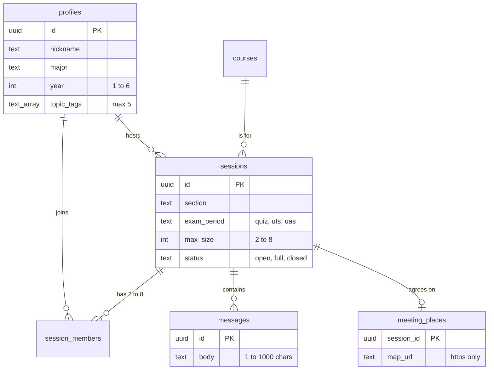
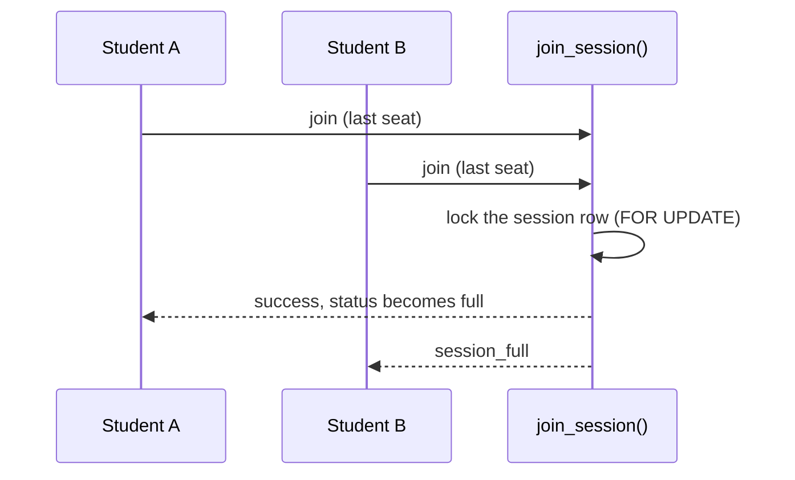

Privacy is enforced in the database, not only in the UI. Row Level Security (RLS) is on for all six tables.

## Who can read what

| Table | Read | Write |
| --- | --- | --- |
| `profiles` | The owner, and members of a shared session | The owner |
| `courses` | Any signed-in user | Nobody (seeded) |
| `sessions` | Any signed-in user, for open or full sessions | The host |
| `session_members` | Members of that session | Only `join_session()` and the host trigger (after the v1.1 migration) |
| `messages` | Members of that session | Members, as themselves |
| `meeting_places` | Members of that session | Members |

## Joining a session

## November 2026 hardening

[`supabase/migrations/20261125000000_harden_join_and_feed.sql`](../supabase/migrations/20261125000000_harden_join_and_feed.sql) fixes two gaps found while checking the proposal against the code:

1. **Seats could be taken without `join_session()`.** A policy let any signed-in user insert themselves into `session_members` through the REST API, skipping the capacity and status checks. The policy is removed; the join function and the host trigger are `SECURITY DEFINER` and keep working.
2. **`sessions_feed` skipped RLS** (`security_invoker = false`) and may have been readable with the public anon key. The view now filters rows like the sessions policy and is revoked from `anon`.

Run it once in the Supabase SQL Editor. The file ends with three checks for QA.

## Secrets

Only `NEXT_PUBLIC_SUPABASE_URL` and the public anon key reach the browser. The service key is never used in the app or committed. `.env.local` is in `.gitignore`.
