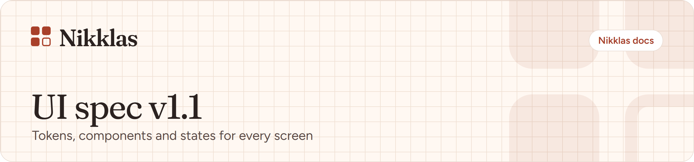
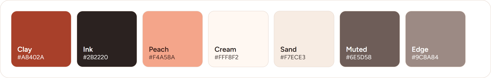

> **v1.1 (25 Nov 2026).** Tokens moved to brand v1.1 for WCAG 2.2 AA. Full rules: [brand guidelines](brand/guidelines.md) · [PDF](brand/Nikklas_Brand_Guidelines_v1.1.pdf).
>
> Also in v1.1: inputs use 16 px text (no iOS zoom), every tap target is at least 44 px, line icons replace emoji, bottom sheets close on Escape or a tap outside, and errors are linked to their fields with `aria-describedby`.

Read with `blueprint.md` and `agent.md`. This is the **only** approved visual style. Do not invent another look, and do not mix in other fonts or colors. Put the tokens below in `tailwind.config` / CSS variables and never hardcode colors or fonts in components. If a screenshot of the mockups is attached, match it; if this file and a screenshot disagree, ask the human.

## 1. Global rules
- Mobile-first, designed at 360-390 px wide. Max content width 480 px, centered on larger screens. Light mode only.
- Touch targets at least 44 px. Text contrast at least 4.5:1.
- Use real `<button>`, `<a>`, `<label>` + `<input>`. Icon-only buttons need `aria-label`.
- All text comes from `messages/id.json` and `messages/en.json` (default `id`). No hardcoded strings.
- Every list and form has loading, empty and error states (section 5).
- Tone: warm, low-pressure, short sentences. Never shame the user.

## 2. Design tokens

| Token | Value |
|---|---|
| `font-display` | **Fraunces** (serif, SOFT 30). 400 for h1 and page titles, 600 for card and section titles. Never 700 |
| `font-body` | **Figtree** 400/500/600 for everything else |
| `bg` | #FFF8F2 (cream) with grid texture (below) |
| `surface` | #FFFFFF |
| `border` | #E9DCD3 (decorative dividers and card edges only) |
| `edge` | #9C8A84 (inputs, selects and outline buttons: 3.3:1, WCAG 1.4.11) |
| `sand` | #F7ECE3 (chips, notes, quiet panels) |
| `grid-line` | #EFDFD2 |
| `text` / `text-2` / `muted` | #2B2220 (14.8:1) / #5A4A46 (8.0:1) / #6E5D58 (5.9:1) |
| `primary` / `on-primary` | #A8402A (clay) / #FFFFFF (6.1:1). The only filled button colour |
| `peach` / `on-peach` | #F4A58A / #3B1F1A (7.6:1). Selected chips, own chat bubbles, language switch |
| `primary-text` | #A8402A (links, active nav, focus ring) |
| `tag-bg` / `tag-text` | #F7ECE3 / #5A4A46 (lavender removed in v1.1: one accent, no violet) |
| `radius-card` / `radius-control` | 24 px / 16 px |
| `shadow-card` | 0 1px 0 rgba(43,34,32,.04): a hairline, no blurred shadow at rest |
| Success | text #166534 on #DCFCE7 |
| Error | text #991B1B on #FEE2E2 |

**Grid texture (screen background):** two 1 px line layers on `bg`, spacing 28 px, in `grid-line`:
`linear-gradient(grid-line 1px, transparent 1px), linear-gradient(90deg, grid-line 1px, transparent 1px)` with `background-size: 28px 28px`. Cards, inputs and chat bubbles sit on `surface` (solid white) so text never sits on the grid lines except headings and short labels.

**Type scale:** wordmark Fraunces 700 56 px in `primary-text`; h1 Fraunces 700 30/1.15; h2 and card title Fraunces 700 18; body Inter 15/1.4; label Inter 13/600; caption Inter 13/400 `muted`.
**Spacing:** 4 px grid; screen padding 20 x 18; gap 14 between blocks, 8 inside cards.

## 3. Components
- **Button primary:** 48 px high, `primary` bg, `on-primary` text, Inter 600 15 px, `radius-control`. **Secondary:** `surface` bg, 1 px `border`, `text` color. Disabled: 50% opacity.
- **Input / select:** 48 px, 1 px `border`, `surface` bg, `radius-control`, label above (13/600). Error: red text under the field plus red border.
- **Chip (tag/filter):** pill, `tag-bg` / `tag-text`, 13/600, padding 12 x 14. Selected filter chip: `primary` bg with `on-primary` text.
- **Session card:** `surface`, 1 px `border`, `radius-card`, `shadow-card`. Order: course + section (Fraunces 18 bold), chips (exam period, topics), time and seats left (muted), "Gabung" button. Full session: chip "Penuh", button disabled.
- **Chat bubble:** others on `surface` with `border`; own messages on `primary` with `on-primary` text, right aligned, max width 75%, `radius-card`. Others' messages show the sender nickname.
- **Meeting place card:** `surface` card with title (Fraunces), description (muted), "Buka peta" chip-link (`https` only, new tab, `rel="noopener noreferrer"`) and an "Ubah" button for members.
- **Bottom nav:** 3 items (Jelajah, Sesi saya, Pengaturan), 1 px top `border`, active item in `primary-text` and bold.
- **Language switch:** two chips (ID, EN) top-right on the entry screen; a select in Settings.

## 4. Screens
1. **Masuk (entry):** language chips top-right; wordmark "Nikklas", tagline "Temukan teman belajarmu.", one-line value text; primary "Lanjut sebagai tamu"; note that guest accounts live in this browser and phone numbers are never shown.
2. **Profil (setup):** nickname, major, year, topic chips (max 5; block the 6th with a message), "Simpan dan lanjut" pinned to the bottom.
3. **Feed:** h1 "Sesi belajar", filter chips (course, section, exam period, topic) that open a bottom sheet, session cards, bottom nav. Floating "Buat sesi" button above the nav.
4. **Buat sesi:** course, section and exam period selects, topics, date/time, group size 2-8, "Posting sesi". Inline validation.
5. **Ruang sesi (room):** header (course + section in Fraunces, then exam period, time, member count), member chips, meeting place card, chat list (auto-scroll to newest), message input + "Kirim" pinned at the bottom.
6. **Sesi saya:** cards for hosted or joined sessions with status chip (Terbuka, Penuh, Selesai) and "Buka ruang".
7. **Pengaturan:** profile summary card, language select, "Ubah profil", guest-account note.

## 5. States and messages (id / en)
- Empty feed: "Belum ada sesi. Jadilah yang pertama!" / "No sessions yet. Be the first!" with a primary "Buat sesi" button.
- No filter results: "Tidak ada sesi yang cocok. Coba ubah filter." with "Hapus filter".
- Loading: 3 skeleton cards in `surface` with a subtle pulse; chat shows 3 skeleton bubbles.
- Join results: joined (success toast), already joined, group full ("Sesi ini sudah penuh").
- Errors: friendly one-liner plus "Coba lagi". Never show raw error text.
- Empty chat: "Sapa teman belajarmu dulu."
- Meeting place not set: "Belum ada tempat. Usulkan satu!"

## 6. Motion and accessibility
- Subtle motion only: 150-200 ms fades and button press feedback. Respect `prefers-reduced-motion`.
- Visible keyboard focus ring (2 px `primary-text`) on all interactive elements.
- Never rely on color alone for status; pair it with text.

## 7. Do not
- Do not use other fonts, other accent colors, gradients, dark mode or emoji icons.
- Do not put body text, labels, chips or chat in Fraunces.
- Do not place text directly on the grid except headings and short captions.
