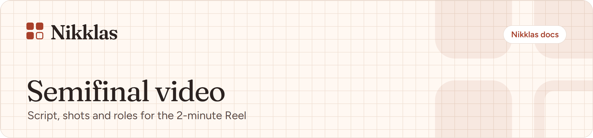
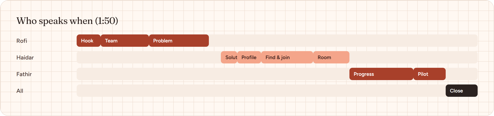

Vertical 9:16 Reel, under 2 minutes, English, posted on Rofi's Instagram and submitted as a link. Rofi, Haidar and Fathir each record alone; the app screens and graphics are added in the edit and labelled "Simulated UI".

| Who | Script | Teleprompter (open on a phone) |
| --- | --- | --- |
| Rofi | [Script_Rofi.pdf](Rofi/Script_Rofi.pdf) | [Teleprompter_Rofi.html](Rofi/Teleprompter_Rofi.html) |
| Haidar | [Script_Haidar.pdf](Haidar/Script_Haidar.pdf) | [Teleprompter_Haidar.html](Haidar/Teleprompter_Haidar.html) |
| Fathir | [Script_Fathir.pdf](Fathir/Script_Fathir.pdf) | [Teleprompter_Fathir.html](Fathir/Teleprompter_Fathir.html) |
| Everyone (editing) | [Nikklas_Video_Script.pdf](Nikklas_Video_Script.pdf) | [teleprompter.html](teleprompter.html) |

Clips due in the shared Drive folder by **28 November, 21:00**. The earlier 4-speaker plan is in [archive-4-speaker.md](archive-4-speaker.md).

Draft v1.2 · 25 November 2026. Vertical 9:16, 1:50, 200 spoken words, English.

| # | Time | Who | Line | On screen |
| --- | --- | --- | --- | --- |
| 1 | 0:00–0:07 | Rofi (VO) | In a class chat of three hundred students, asking for a study partner usually goes nowhere. | Edit: a made-up class group chat (‘Kalkulus K01 2026’, 300 members) scrolls fast; one bubble ‘Ada yang mau belajar bareng?’ sinks under stickers and notices. |
| 2 | 0:07–0:20 | Rofi | We’re Satu Orang Satu Ubin, competing in STACK 2026, Case One: Smarter Campus and Learning. I’m Rofi. This is Haidar, and Fathir. And Adhi, our founder, orchestrates the whole project. | Lower-third name tags. Card: ‘Satu Orang Satu Ubin · STACK 2026 · Case 1: Smarter Campus and Learning’. Adhi shown as a name tag: ‘Adhi · Founder’. Haidar’s and Fathir’s clips cut in as Rofi says their names. |
| 3 | 0:20–0:36 | Rofi | Students who commute, transfer, or are just a little shy often study alone. Study requests get buried. Joining a class chat shows your phone number to everyone. And meetups end up empty, or too crowded. | Three big lines, one at a time: ‘Requests get buried’ · ‘Your number, shown to everyone’ · ‘No group size’. |
| 4 | 0:36–0:44 | Haidar | So we built Nikklas: a study-group finder that matches you by course, class section, and exam. | Nikklas logo builds (three seats fill, one stays open). Tagline: ‘Find your study people.’ |
| 5 | 0:44–0:51 | Haidar (VO) | You start with a nickname, your major, and your year. No phone number. Ever. | Edit: entry screen, then profile form fills in (nickname, major, year). Label: ‘Simulated UI’. |
| 6 | 0:51–1:05 | Haidar (VO) | Filter by course and exam, and join in one tap. Each group has two to eight seats, and the last seat goes to exactly one person. | Edit: feed, filter MK101 + UTS, tap ‘Join’, seats go 2/4 → 3/4; last seat taken, card turns ‘Full’. |
| 7 | 1:05–1:15 | Haidar (VO) | Members get a private room to chat live and agree on where to meet. | Edit: two phones, a message appears live on the other; meeting place card ‘Central Library, 2nd floor’ with ‘Open map’. |
| 8 | 1:15–1:32 | Fathir | Today, profiles, filters, joining, live chat, and meeting places already work, in English and Indonesian. For Final Day, we’ll add verified campus sign-in, reporting and moderation, and calendar reminders. | Checklist slides in. Done: profiles, filters, join, live chat, meeting place, ID/EN. Final Day: campus sign-in, reporting, reminders. |
| 9 | 1:32–1:41 | Fathir | After that, a two-week pilot with seven students will show how fast groups fill up. | Card: ‘2-week pilot · 7 students · time to fill, fill rate, comfort rating’. |
| 10 | 1:41–1:50 | All three | Nikklas. Find your study people. | Three faces in a vertical split (Rofi, Haidar, Fathir), each saying the line; then end card: logo, ‘Find your study people.’, ‘STACK 2026 · Case 1’. |

## Shots

- **1. Hook**: B-roll B1: hand holding a phone, screen green, thumb scrolling. Classroom seat. _Delivery: Voice-over. Calm, a little flat on ‘nowhere’. No smile in the voice._
- **2. Team**: A-roll R1: Rofi to camera in a corridor, chest-up. H0 and F0: Haidar and Fathir each film their own 2-second clip, looking into the lens and nodding. _Delivery: Friendly, eye contact with the lens the whole time. Pause briefly after each name; their clips are cut in there._
- **3. Problem**: A-roll R2: Rofi in the classroom, seated. B-roll B2: someone studying alone at the back of an empty class. _Delivery: Slightly slower. Short pause between each problem so the text can land._
- **4. Solution**: A-roll H1: Haidar to camera, holding his phone (screen green) at chest height. _Delivery: Energy up a notch. Say ‘Nikklas’ clearly: NICK-las, like ‘Nicholas’ without the ‘ho’._
- **5. Profile**: B-roll B3: close-up thumb tapping a green phone screen, 3 to 4 taps. _Delivery: Voice-over. Small pause before ‘Ever.’_
- **6. Find and join**: B-roll B7: Haidar holds the phone toward camera and taps once, firmly. _Delivery: Voice-over. Steady pace; this is the key product line._
- **7. Room**: B-roll B4: Haidar alone, two phones side by side on a desk, both green; type on the left phone, then pick up the right one. _Delivery: Voice-over. Warm._
- **8. Progress**: A-roll F1: Fathir to camera in the corridor. _Delivery: Clear and matter-of-fact. Slight pause after ‘Indonesian’._
- **9. Pilot**: A-roll F2: same spot, tighter framing. _Delivery: Finish strong on ‘fill up’._
- **10. Close**: A-roll R3, H2, F3: each person films the same line alone, same framing as their other clips. _Delivery: Everyone records the full line alone: ‘Nikklas. Find your study people.’ (NICK-las). Smile and hold still for 2 seconds after. The edit stacks the three takes._

## B-roll

- **B1** Hand holding a phone, green screen, thumb scrolling slowly upward (Classroom seat, 8 s, for Hook)
- **B2** Rofi: studying alone at the back of an empty class, phone on a tripod or propped on a bag (Classroom, 6 s, for Problem)
- **B3** Close-up thumb tapping a green phone screen, 3 to 4 slow taps (Any desk, 8 s, for Profile)
- **B4** Haidar: two phones side by side, both green, type on one then pick up the other (Desk, 10 s, for Room)
- **B5** Wide shot of the corridor, people walking past, camera still (Corridor, 5 s, for Transitions)
- **B6** Each person: 5 s of yourself studying or walking, from the side, no talking (Your spot, 5 s each, for Transitions)
- **B7** Haidar holds the phone toward camera and taps once, firmly (Corridor, 5 s, for Find and join)
