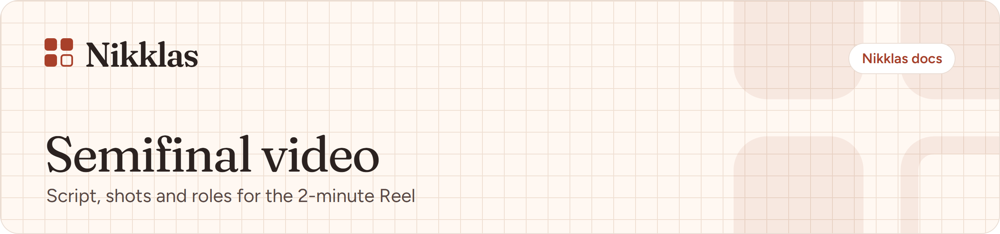

<p align="center"></p>
> **Archived.** The first 4-speaker plan. The team records solo, with three speakers; the current script is in [`README.md`](README.md).

# Nikklas — Semifinal Video Script & Presentation Guide (4-Speaker Revision)

**Competition:** STACK 2026 (GDGoC ITB)  
**Track:** Case 1 — Smarter Campus and Learning  
**Team Name:** Satu Orang Satu Ubin  
**Product Name:** Nikklas  
**Max Duration:** 2 Minutes (120 seconds)  
**Target Duration:** ~1 Minute 50 Seconds (Leaves a 10-second buffer under the 2:00 limit)  
**Format:** English voiceover, hardcoded English subtitles, 1080p minimum resolution  
**Visual Style:** Concept presentation slides + Figma UI mockups/wireframes (No live application shown)

---

## 1. Official Video Assessment Rubric Mapping

According to the **STACK 2026 Handbook (Video Assessment Rubric, p. 16)**, the video is evaluated on the following 5 criteria. This script is strictly partitioned among **4 team members**, with each member taking ownership of one primary rubric criterion:

| Speaker | Assigned Rubric Criterion | Rubric Weight | Time Allocation | Word Count |
|---|---|---|---|---|
| **Person 1** | **Criterion 1: Team & Context Introduction**<br>Clear and concise introduction of the team, project, selected case, and relevant problem context. | 15% | 0:00 – 0:20 (20s) | ~48 words |
| **Person 2** | **Criterion 2: Problem & Solution Explanation**<br>Clarity in explaining the identified problem, target users, proposed solution, and expected benefits. | 25% | 0:20 – 0:46 (26s) | ~64 words |
| **Person 3** | **Criterion 3: User Flow / Prototype Showcase**<br>Effectiveness in visually demonstrating the main user journey, proposed workflow, or early prototype, including how users interact with the solution. | 30% | 0:46 – 1:24 (38s) | ~94 words |
| **Person 4** | **Criterion 4: Progress Honesty & Next Steps**<br>Clear distinction between completed features and planned development, along with a realistic explanation of remaining tasks. | 20% | 1:24 – 1:50 (26s) | ~68 words |
| **All Team** | **Criterion 5: English & Production Quality**<br>Understandable English narration/subtitles, clear audio, readable visuals, effective pacing, and 2-minute compliance. | 10% | Applied across all 4 sections | Total: ~274 words |

---

## 2. Product Abstract

> **Nikklas** is a lightweight, privacy-first peer study-group matchmaking platform designed for Indonesian university students. In large lecture classes, commuter students, newcomers, and introverted learners frequently struggle with the "cold-start" social friction of finding study partners for quizzes, midterms (UTS), and finals (UAS). Nikklas eliminates this barrier through course-specific and exam-targeted session discovery, zero-friction guest entry, strict privacy boundaries (displaying only nicknames, academic year, and major without revealing phone numbers or emails), and atomic seat-reservation mechanics to ensure groups never exceed manageable study limits.

---

## 3. Four-Person Spoken Script (Word-for-Word)

```
================================================================================
PART 1: TEAM & CONTEXT INTRODUCTION (0:00 – 0:20 | ~20 Seconds)
Speaker: PERSON 1
Rubric Focus: Team & Context Introduction (15% Weight)
Visuals: Slide 1 (Title slide with STACK 2026 logo, Team Name "Satu Orang Satu Ubin", 
         Case 1: Smarter Campus and Learning, and Nikklas brand mark) 
         followed by Slide 2 (Graphic of 300-student lecture hall & isolated commuter student).
================================================================================
```

> **[PERSON 1]:**  
> *"Hello judges and mentors of STACK 2026. We are Team Satu Orang Satu Ubin, presenting for Case 1: Smarter Campus and Learning.*  
> 
> *In Indonesian universities, thousands of freshmen and commuter students face a persistent academic barrier: studying in isolation due to large class sizes and disconnected campus networks."*

---

```
================================================================================
PART 2: PROBLEM & SOLUTION EXPLANATION (0:20 – 0:46 | ~26 Seconds)
Speaker: PERSON 2
Rubric Focus: Problem & Solution Explanation (25% Weight)
Visuals: Slide 3 (Infographic contrasting chaotic 300-person WhatsApp groups vs. student anxiety) 
         transitioning to Slide 4 (Product introduction: Nikklas value proposition, 3 pillars: 
         Course-Targeted, Privacy-First, Atomic Group Limits).
================================================================================
```

> **[PERSON 2]:**  
> *"Our target users are students preparing for exams who lack established social circles. Currently, asking strangers in chaotic 300-person class chats causes high social anxiety and rarely yields balanced study groups.*  
> 
> *Our solution is **Nikklas**: a focused peer study-group finder that matches students by course code and exam period, cutting search friction from days to seconds while protecting student privacy."*

---

```
================================================================================
PART 3: USER FLOW & PROTOTYPE SHOWCASE (0:46 – 1:24 | ~38 Seconds)
Speaker: PERSON 3
Rubric Focus: User Flow / Prototype Showcase (30% Weight — Highest Score!)
Visuals: Figma mobile mockup walkthrough with clean transitions:
         • Mockup A: Rapid student profile setup (nickname, major, year, tags — NO phone/email).
         • Mockup B: Filtered feed displaying courses (Calculus, Physics) and exam chips (Quiz, UTS).
         • Mockup C: Realtime seat counter and 1-tap atomic join button.
         • Mockup D: Private group coordination space with embedded Google Maps meeting place.
================================================================================
```

> **[PERSON 3]:**  
> *(Show Mockup A)*  
> *"Here is how students interact with our prototype.*  
> *First, students set a lightweight academic profile—nickname, major, and year—without exposing sensitive phone numbers or personal emails.*  
> 
> *(Show Mockup B & C)*  
> *Next, learners filter the feed by course code and upcoming exam period. Groups are strictly capped at two to eight members, with atomic capacity locks that automatically close full sessions.*  
> 
> *(Show Mockup D)*  
> *Finally, enrolled peers enter a private room to coordinate agendas and agree on a physical meeting place, linked directly to Google Maps."*

---

```
================================================================================
PART 4: PROGRESS HONESTY & NEXT STEPS (1:24 – 1:50 | ~26 Seconds)
Speaker: PERSON 4
Rubric Focus: Progress Honesty & Next Steps (20% Weight) + Conclusion
Visuals: Slide 5 (Dual Roadmap diagram: "Current Validated Foundations" on the left vs. 
         "Planned Final Day Build Milestones" highlighted on the right) 
         followed by Slide 6 (Closing slide with team acknowledgment).
================================================================================
```

> **[PERSON 4]:**  
> *"To ensure progress honesty: in this semifinal stage, we have established our complete system architecture, relational database schemas with Row Level Security, and validated our core interaction mockups.*  
> 
> *For the Final Day build session, our remaining tasks are: integrating verified institutional `.ac.id` single sign-on, implementing student safety reporting mechanisms, and building automated calendar reminders.*  
> 
> *Thank you from Team Satu Orang Satu Ubin!"*

---

## 4. Speaker Timing & Recording Quick Reference

| Speaker | Section Title | Word Count | Speaking Time | Breathing & Transition Buffer |
|---|---|---|---|---|
| **Person 1** | Team & Problem Context | 48 words | ~20 sec | 0:00 &rarr; 0:20 |
| **Person 2** | Problem & Solution Details | 64 words | ~26 sec | 0:20 &rarr; 0:46 |
| **Person 3** | Prototype & User Flow Showcase | 94 words | ~38 sec | 0:46 &rarr; 1:24 |
| **Person 4** | Progress Honesty & Final Day Plan | 68 words | ~26 sec | 1:24 &rarr; 1:50 |
| **Buffer** | Outro fade & visual title card | — | ~10 sec | 1:50 &rarr; 2:00 (Safe finish!) |
| **Total** | | **274 words** | **1 min 50 sec** | **Under 2-min limit** |

---

## 5. Production & Rubric Checklist Before Submission

- [ ] **1080p Resolution:** Video exported at minimum 1920 × 1080.
- [ ] **Hardcoded Subtitles:** English subtitles rendered at bottom-center with high contrast (white text with dark outline/box).
- [ ] **Voice Levels:** Normalize audio across all 4 speakers so volume remains consistent when switching voices.
- [ ] **Strict Time Limit:** Ensure final exported video runtime is between **1:45 and 1:55** (strictly below 2:00:00).
- [ ] **No Rule-Breaking Visuals:** Only presentation slides, diagrams, and Figma mobile mockups shown (no live code, no terminal, no `localhost` address bars).
- [ ] **Progress Honesty Emphasized:** Person 4 explicitly stated what is completed conceptually vs. what remains for the Final Day build session.
